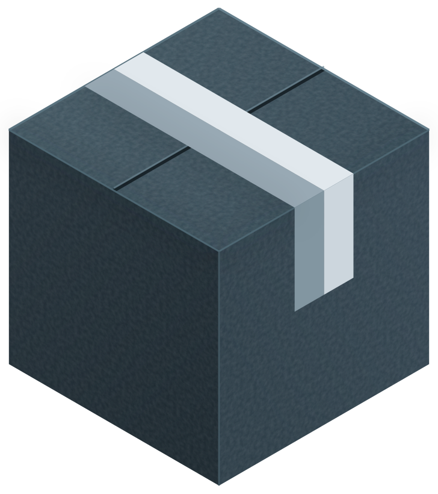

<div align="center">

&nbsp;&nbsp;&nbsp;&nbsp;&nbsp;&nbsp;&nbsp;&nbsp;&nbsp;

# 🛑 RFU 去广告规则

拦得准 · 放得对 · 负担轻

[](#-拿来即用)
[](#-拿来即用)
[](https://github.com/VME98/jinx-rules)
[](https://github.com/RiverFlowsInUUU/RFU-Rules/actions/workflows/ci.yml)

[](#-拿来即用)
[](#-拿来即用)
[](#-拿来即用)
[](#-拿来即用)

</div>

> 🤖 AI agent 维护入口 → [`skill/SKILL.md`](skill/SKILL.md)

一份域名名单，四个代理内核 —— **mihomo · Surge · Egern · sing-box**。

换客户端，不必换名单。**拦的相同。放的相同。误杀的救法也相同 —— 49 条放行，一处维护。**
不同的只是格式 —— 那是我们的事，不是你的事。

## 📥 拿来即用

| <div align="center">客户端</div> | <div align="center">🚫 拦截规则集</div> | <div align="center">✅ 放行规则集</div> |
|:--|:--|:--|
| **mihomo** / OpenClash | [`mihomo-ads.yaml`](https://raw.githubusercontent.com/RiverFlowsInUUU/RFU-Rules/main/mihomo-ads.yaml) `9535` | [`mihomo-direct.yaml`](https://raw.githubusercontent.com/RiverFlowsInUUU/RFU-Rules/main/mihomo-direct.yaml) `49` |
| **Surge** / **Egern** | [`surge-ads.list`](https://raw.githubusercontent.com/RiverFlowsInUUU/RFU-Rules/main/surge-ads.list) `9535` | [`surge-direct.list`](https://raw.githubusercontent.com/RiverFlowsInUUU/RFU-Rules/main/surge-direct.list) `49` |
| **sing-box** | [`sing-box-ads.json`](https://raw.githubusercontent.com/RiverFlowsInUUU/RFU-Rules/main/sing-box-ads.json) `9535` | [`sing-box-direct.json`](https://raw.githubusercontent.com/RiverFlowsInUUU/RFU-Rules/main/sing-box-direct.json) `49` |

链接即地址。备用镜像换前缀：`https://cdn.jsdelivr.net/gh/RiverFlowsInUUU/RFU-Rules@main/`。

<details>
<summary>🍂 想再叠加 <b>AWAvenue</b>？（可选 —— 969 条已含 912）</summary>

| <div align="center">客户端</div> | <div align="center">🚫 拦截规则集</div> |
|:--|:--|
| **mihomo** / OpenClash | [`AWAvenue-Ads-Rule-Clash-Classical.yaml`](https://raw.githubusercontent.com/TG-Twilight/AWAvenue-Ads-Rule/main/Filters/AWAvenue-Ads-Rule-Clash-Classical.yaml) `965` |
| **Surge** | [`AWAvenue-Ads-Rule-Surge-RULE-SET.list`](https://raw.githubusercontent.com/TG-Twilight/AWAvenue-Ads-Rule/main/Filters/AWAvenue-Ads-Rule-Surge-RULE-SET.list) `965` |
| **sing-box** | [`AWAvenue-Ads-Rule-Singbox.json`](https://raw.githubusercontent.com/TG-Twilight/AWAvenue-Ads-Rule/main/Filters/AWAvenue-Ads-Rule-Singbox.json) `965` |

重复规则对结果无副作用。第三方规则由对方托管，只给官方地址。

</details>

## 🚦 拦得准 · 放得对

只记一条：**放行在前，拦截在后，其余分流接在后面。**

```text
1. 放行 → DIRECT   ← 49 条功能域，推送与登录全靠它
2. 拦截 → REJECT   ← 9535 条，四类域名
3. 其余分流        ← 照你原有的走
```

> [!IMPORTANT]
> 拦截集收了 `umeng.com`、`tanx.com` 这类平台主域，放行清单保的是同族里的功能子域 —— 更具体的先命中，各得其所。**删掉放行行，推送和微信登录立刻失效。** 重叠当前是 **42 条**，逐条列在 [`OVERLAP.md`](OVERLAP.md)。

> [!WARNING]
> Surge 拦截行**不要加 `pre-matching`** —— 它抢先于一切规则生效，放行清单整份作废。用 `extended-matching` 即可。

<details>
<summary>🔷 <b>mihomo / OpenClash</b></summary>

```yaml
rule-providers:
  rfu-ads:
    type: http
    behavior: classical
    format: yaml
    url: "https://raw.githubusercontent.com/RiverFlowsInUUU/RFU-Rules/main/mihomo-ads.yaml"
    path: ./rule_provider/rfu-ads.yaml
    interval: 604800
  rfu-direct:
    type: http
    behavior: classical
    format: yaml
    url: "https://raw.githubusercontent.com/RiverFlowsInUUU/RFU-Rules/main/mihomo-direct.yaml"
    path: ./rule_provider/rfu-direct.yaml
    interval: 604800

rules:
  - RULE-SET,rfu-direct,DIRECT
  - RULE-SET,rfu-ads,REJECT
```

> [!IMPORTANT]
> OpenClash 需关闭 `绕过中国大陆 IP`（`china_ip_route`）：大陆 IP 直接放行、不进内核，规则会整体失效。

```bash
uci set openclash.config.china_ip_route='0' && uci commit openclash
/etc/init.d/openclash restart
```

</details>

<details>
<summary>🔶 <b>Surge</b></summary>

```
[Rule]
RULE-SET,https://raw.githubusercontent.com/RiverFlowsInUUU/RFU-Rules/main/surge-direct.list,DIRECT,extended-matching
RULE-SET,https://raw.githubusercontent.com/RiverFlowsInUUU/RFU-Rules/main/surge-ads.list,REJECT,extended-matching
```

`extended-matching` 让域名规则在 App 直连 IP 时按 TLS SNI / HTTP Host 兜底，缺了它拦截会大批失效。

</details>

<details>
<summary>🟣 <b>Egern</b>（直接复用 Surge 那份）</summary>

```yaml
rules:
- rule_set:
    name: RFU-Direct
    match: https://raw.githubusercontent.com/RiverFlowsInUUU/RFU-Rules/main/surge-direct.list
    policy: DIRECT
    update_interval: 604800
- rule_set:
    name: RFU-Ads
    match: https://raw.githubusercontent.com/RiverFlowsInUUU/RFU-Rules/main/surge-ads.list
    policy: AD
    update_interval: 604800
```

DNS 层拒答（可选）与组名改法见[详情](DetailsReadme/DetailsReadme.md)。

</details>

<details>
<summary>🔷 <b>sing-box</b>（1.14.2 实测）</summary>

```json
{
  "route": {
    "rule_set": [
      { "type": "remote", "tag": "rfu-direct", "format": "source",
        "url": "https://raw.githubusercontent.com/RiverFlowsInUUU/RFU-Rules/main/sing-box-direct.json",
        "update_interval": "7d" },
      { "type": "remote", "tag": "rfu-ads", "format": "source",
        "url": "https://raw.githubusercontent.com/RiverFlowsInUUU/RFU-Rules/main/sing-box-ads.json",
        "update_interval": "7d" }
    ],
    "rules": [
      { "rule_set": ["rfu-direct"], "outbound": "direct" },
      { "rule_set": ["rfu-ads"], "action": "reject" }
    ]
  }
}
```

</details>

## 🧾 一目了然

| | | |
|:--|:--|:--|
| 🚫 拦截 | **9535 条** | 广告 · 统计 · 隐私采集 · PCDN；灰产在构建时就被排除 |
| ✅ 放行 | **49 条** | 43 条精确 + 6 条后缀（含 5 条手工补充） |
| 🧩 同源 | 四端逐条等价 | 换客户端不换名单 |
| 🪶 轻量 | 纯域名后缀 | 无通配 · 无正则 · 无 IP，软路由与手机都跑得动 |
| 📌 上游快照 | jinx 钉死 `3.2.3` · 其余每周刷新 | 构建只读快照，定时工作流自动更新 |

## 📖 按需查阅

| 文档 | 内容 |
|:--|:--|
| 📘 [`DetailsReadme`](DetailsReadme/DetailsReadme.md) | 数据从哪来 · 为何这么取舍 · 转换原理 · 一致性保证 |
| 🧪 [`skill/SKILL.md`](skill/SKILL.md) | 构建链 · 断言口径 · 加新源流程 |
| 🔨 想本地构建？ | `bash skill/scripts/regen.sh` —— 一条命令重跑六份产物 + 双闸门 |
| 🧷 [`OVERLAP.md`](OVERLAP.md) · [`WHITELIST-SLIM.md`](WHITELIST-SLIM.md) | 重叠清单 · 瘦身留痕（构建生成，CI 校验） |
| 📄 [`NOTICE.md`](NOTICE.md) | 来源与使用条件（数据 vs 脚本分开授权） |
| 📅 [`CHANGELOG.md`](CHANGELOG.md) | 变动记录 |

## 📚 来源

本仓站在七个上游的肩上，名单如下 —— 各归其位，皆可溯源：

| 来源 | 本仓取用 |
|:--|:--|
| [VME98/jinx-rules](https://github.com/VME98/jinx-rules) | 基线主源 · 黑白名单明文 · 数据 `3.2.3`（2026-10-18 冻结） |
| [217heidai/adblockfilters](https://github.com/217heidai/adblockfilters) | 聚合规则站 · lite 档与 china 直连清单 |
| [TG-Twilight/AWAvenue-Ads-Rule](https://github.com/TG-Twilight/AWAvenue-Ads-Rule) | 秋风规则 · 国内 App 广告 |
| [AdguardTeam/AdguardFilters](https://github.com/AdguardTeam/AdguardFilters) | AdGuard 中文过滤器 |
| [cjx82630/cjxlist](https://github.com/cjx82630/cjxlist) | CJX's Annoyance List · 中文骚扰补充 |
| [xinggsf/Adblock-Plus-Rule](https://github.com/xinggsf/Adblock-Plus-Rule) | 视频广告规则 |
| [damengzhu/banad](https://github.com/damengzhu/banad) | jiekouAD · 接口广告收集 |

快照全部落盘在 `upstream/`，构建不联网。数据版权归各上游，本仓不主张；任一上游作者有异议，开 issue 即下架对应来源。

---

<div align="center">

🛑 拦得准 · 放得对 · 负担轻

</div>
